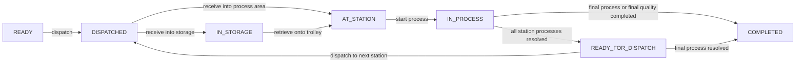

# Lot status flow

This describes the current implementation. Lot status is separate from station visit and process execution status.

Lots are created as `READY` after the style is released. A trolley is required for dispatch. Receiving a dispatched lot into storage or a process area determines its next status. Starting a process sets `IN_PROCESS`; when all processes at a station are completed or skipped, the lot becomes `READY_FOR_DISPATCH`. Final completion closes the lot. A manager route revision may set an in-progress lot to `AT_STATION` or `READY_FOR_DISPATCH` depending on the revised route. A non-completed lot can be cancelled and becomes `CANCELLED`. Supervisor process corrections can also affect the resulting lot status.

`DRAFT` and `AT_QC` are declared lot status values, but the current workflow does not assign them. Quality is handled through process execution and final quality completion rather than an `AT_QC` lot transition. `COMPLETED` and `CANCELLED` are terminal for ordinary operations.
